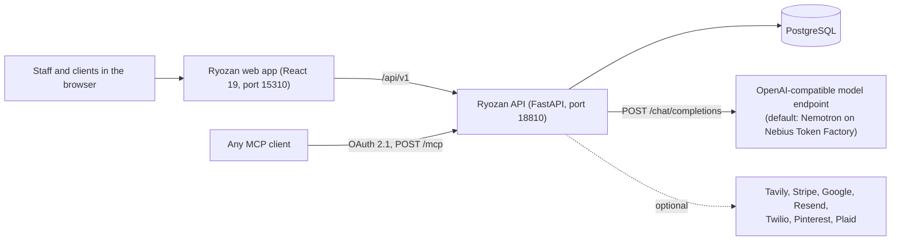

# Ryozan (梁山泊)

**A self-hosted shop operating system for tattoo studios and other artist businesses.**

Ryozan runs a studio's bookings, client messages, waivers, payments and flash in one web app. A crew of AI agents works alongside the staff. Each install serves one studio. The agents run on any OpenAI-compatible model endpoint; the default is NVIDIA Nemotron on Nebius Token Factory.

License: Apache-2.0 ([`LICENSE`](LICENSE)).

### Why I built this

> *"I needed help managing my business so I built my shop's app and website from scratch. I taught myself how to develop, build and ship full stack applications using AI. What I didn't expect was to fall in love with the process of architecting orchestrated software and now am founding a tech company called Ark Omnitek made by a tattooer, built for artists and creators. I also wanted to build something that would help other tattooers like my dad. But if it didn't help mine, what good would that do? Once my analytics proved it worked on my shop first, I knew I could confidently give him something that works and put it out there in the world."*
> **Justin Walker**

## Features

Every item below points at the code that implements it.

| Feature | What it does | Where |
| --- | --- | --- |
| Bookings | Booking requests, approvals, deposits and the studio schedule | [`bookings.py`](api/app/api/v1/endpoints/bookings.py), [`calendar.py`](api/app/api/v1/endpoints/calendar.py) |
| Unified inbox | Client threads from email, SMS and WhatsApp in one place | [`conversations.py`](api/app/api/v1/endpoints/conversations.py), [`email_inbound.py`](api/app/api/v1/endpoints/email_inbound.py), [`sms.py`](api/app/api/v1/endpoints/sms.py), [`whatsapp.py`](api/app/api/v1/endpoints/whatsapp.py) |
| Waivers and documents | Signed consent waivers, document templates and signing | [`waiver.py`](api/app/api/v1/endpoints/waiver.py), [`documents.py`](api/app/api/v1/endpoints/documents.py) |
| Flash | Upload flash sheets, split them into designs with AI, publish them | [`flash.py`](api/app/api/v1/endpoints/flash.py) |
| Payments | Stripe Connect onboarding for artists, day-of balance checkout, gift cards | [`stripe_connect.py`](api/app/api/v1/endpoints/stripe_connect.py), [`pos.py`](api/app/api/v1/endpoints/pos.py), [`gift_cards.py`](api/app/api/v1/endpoints/gift_cards.py) |
| Ledger | A standalone integer-cent double-entry ledger library. The API does not import it yet. | [`packages/ryozan-econ`](packages/ryozan-econ) |
| Client rewards | Rewards, wallet receipts and inventory for clients | [`rewards.py`](api/app/api/v1/endpoints/rewards.py) |
| References | Shared reference library for staff, and Pinterest boards | [`references.py`](api/app/api/v1/endpoints/references.py), [`pinterest.py`](api/app/api/v1/endpoints/pinterest.py) |
| Follow-ups | A small CRM task pipeline for shop follow-ups | [`crm.py`](api/app/api/v1/endpoints/crm.py) |
| Push notifications | Web Push to staff and client devices | [`push.py`](api/app/api/v1/endpoints/push.py) |
| Agent crew | Eight agents coordinated by Gala, each scoped to one part of the shop | [`gala_chat.py`](api/app/api/v1/endpoints/gala_chat.py) |
| Web search | Agents can search the live web through Tavily | [`web_search.py`](api/app/services/web_search.py) |
| MCP server | Other AI clients can read and act on the shop over MCP with OAuth | [`api/app/mcp`](api/app/mcp) |

Accounts have one of five roles: `collector` (client), `assistant`, `artist`, `admin` and `founder` ([`security.py`](api/app/core/security.py)). Each role sees only what it is allowed to see. A client only ever sees their own bookings, messages and agent memory.

### The agent crew

The crew is styled after the heroes of Ryōzanpaku in Kuniyoshi's *Suikoden* woodblock prints. Each agent has its own model and its own set of tools, and only the roles listed in its profile can talk to it.

| Agent | Shop job | Default model |
| --- | --- | --- |
| Gala | Coordinates the crew (founder and admin only) | `nvidia/Nemotron-3-Ultra-550b-a55b` |
| Sōkō | Shop floor and back of house | `nvidia/nemotron-3-super-120b-a12b` |
| Shishin | Flash drops, deposits, ledger | `nvidia/nemotron-3-super-120b-a12b` |
| Saishin | Scheduling and calendar | `nvidia/nemotron-3-super-120b-a12b` |
| Riki | Social publishing | `nvidia/nemotron-3-super-120b-a12b` |
| Ensei | Front-desk triage | `nvidia/NVIDIA-Nemotron-3-Nano-30B-A3B` |
| Taisō | Inbox | `nvidia/NVIDIA-Nemotron-3-Nano-30B-A3B` |
| Andōzen | Aftercare, waivers, check-ins | `nvidia/NVIDIA-Nemotron-3-Nano-30B-A3B` |
| Rochishin | Flash, style and placement critique (vision) | `nvidia/Nemotron-3.5-Super-VL` |

The profiles live in `AGENT_PROFILES` in [`gala_chat.py`](api/app/api/v1/endpoints/gala_chat.py). The model client and the fallback lanes are in [`ai_routing.py`](api/app/services/ai_routing.py). If an agent's own model fails, the call falls back to the tier lane.

How a turn runs:

1. The web app posts the message to `POST /api/v1/gala/chat` with the signed-in account's token.
2. The API picks the agent, builds a prompt scoped to the account's role, and offers only the tools that agent and role may use.
3. It calls the model endpoint's `POST /chat/completions` with those tools.
4. When the model asks for a tool, the API runs it and loops (at most 5 rounds) until the model writes an answer.
5. The reply carries a receipt for each tool call and data cards that the web app shows under the answer.

Without a model key, agent chat returns a 503 that says to set `NEBIUS_API_KEY`. The rest of the app keeps working.

## What's in v1

v1 is one studio running its own install. The split below comes from the code: the routers in [`router.py`](api/app/api/v1/router.py), the models in [`api/app/models`](api/app/models) and the routes in [`App.tsx`](app/src/App.tsx). No code was removed to draw it.

### Core

What a studio needs to run day to day.

| Area | Code | Off until |
| --- | --- | --- |
| Bookings and schedule: requests, approvals, session types, add-ons, quotes, the staff calendar | [`bookings.py`](api/app/api/v1/endpoints/bookings.py), [`calendar.py`](api/app/api/v1/endpoints/calendar.py), [`session_types.py`](api/app/api/v1/endpoints/session_types.py), [`booking_addons.py`](api/app/api/v1/endpoints/booking_addons.py), [`quotes.py`](api/app/api/v1/endpoints/quotes.py) | Always on. Google Calendar sync needs the Google keys. |
| Client inbox (Courier): threads, contacts, reply templates | [`conversations.py`](api/app/api/v1/endpoints/conversations.py), [`messages.py`](api/app/api/v1/endpoints/messages.py), [`contacts.py`](api/app/api/v1/endpoints/contacts.py), [`email_inbound.py`](api/app/api/v1/endpoints/email_inbound.py), [`sms.py`](api/app/api/v1/endpoints/sms.py), [`whatsapp.py`](api/app/api/v1/endpoints/whatsapp.py) | Always on. Each channel needs its provider keys (Resend, SendGrid or SMTP; Twilio; Meta WhatsApp). |
| Waivers, documents and artist paperwork | [`waiver.py`](api/app/api/v1/endpoints/waiver.py), [`documents.py`](api/app/api/v1/endpoints/documents.py), [`scrolls.py`](api/app/api/v1/endpoints/scrolls.py), [`archive.py`](api/app/api/v1/endpoints/archive.py) | Always on. |
| Flash: upload, split, publish, the client flash shop | [`flash.py`](api/app/api/v1/endpoints/flash.py) | Always on. |
| Payments and deposits: deposit checkout at booking, day-of balance checkout, artist payouts, gift cards | [`bookings.py`](api/app/api/v1/endpoints/bookings.py), [`pos.py`](api/app/api/v1/endpoints/pos.py), [`stripe_connect.py`](api/app/api/v1/endpoints/stripe_connect.py), [`stripe_webhooks.py`](api/app/api/v1/endpoints/stripe_webhooks.py), [`gift_cards.py`](api/app/api/v1/endpoints/gift_cards.py) | `STRIPE_SECRET_KEY`. |
| Agent crew | [`gala_chat.py`](api/app/api/v1/endpoints/gala_chat.py), [`ai_routing.py`](api/app/services/ai_routing.py) | `NEBIUS_API_KEY` (agent chat answers 503 without it). |
| MCP server | [`api/app/mcp`](api/app/mcp) | Always mounted. Clients sign in with OAuth. |
| Accounts, roles and studio settings, notifications, push, follow-ups | [`auth.py`](api/app/api/v1/endpoints/auth.py), [`users.py`](api/app/api/v1/endpoints/users.py), [`studio.py`](api/app/api/v1/endpoints/studio.py), [`integrations.py`](api/app/api/v1/endpoints/integrations.py), [`security.py`](api/app/core/security.py), [`crm.py`](api/app/api/v1/endpoints/crm.py), [`push.py`](api/app/api/v1/endpoints/push.py) | Always on. Push needs the VAPID keys. |

### Optional extras

Gamified, experimental or tied to one studio's tools. There is no feature flag for any of them yet. The last column says what turns each one off today.

| Extra | Code | Can it be switched off today? |
| --- | --- | --- |
| Quests | [`quests.py`](api/app/api/v1/endpoints/quests.py), [`quest_hooks.py`](api/app/services/quest_hooks.py), `/dashboard/quests` | No. Always on for every signed-in account. Starter quests are seeded on every boot ([`main.py`](api/main.py)). |
| RYO coin, rewards and wallet | [`rewards.py`](api/app/api/v1/endpoints/rewards.py) (`/rewards`, `/bttcoin`), [`reward_engine.py`](api/app/services/reward_engine.py), `/dashboard/wallet` | No. Coin is awarded automatically on flash purchases ([`flash.py`](api/app/api/v1/endpoints/flash.py)) and on completed artist paperwork ([`documents.py`](api/app/api/v1/endpoints/documents.py)). Only a manual award needs the `admin` role. |
| Club feed | [`club.py`](api/app/api/v1/endpoints/club.py), `/dashboard/club` | No. Any signed-in account can post. The Club page itself is a coming-soon placeholder. |
| Leaderboards, gauntlets, class | [`GuildPage.tsx`](app/src/pages/dashboard/GuildPage.tsx), [`LootPage.tsx`](app/src/pages/dashboard/LootPage.tsx) | Not built. Guild (staff nav) and Loot (client nav) are coming-soon pages that always show. |
| Finance connectors: Clover POS, Mercury, Plaid | [`econ.py`](api/app/api/v1/endpoints/econ.py), [`plaid.py`](api/app/api/v1/endpoints/plaid.py), `/dashboard/hustle` | Yes, by keys. Each stays off until its keys are set (`CLOVER_*`, `MERCURY_API_TOKEN`, `PLAID_*`). Staff roles only. |
| `ryozan-econ` ledger | [`packages/ryozan-econ`](packages/ryozan-econ) | Nothing to switch. The API does not import it. CI tests it on its own. |
| Artist stash and canvas sessions | [`stash.py`](api/app/api/v1/endpoints/stash.py) | No setting. `artist` role and up. |
| Herald: artist reposts and social broadcasts | [`social_reposts.py`](api/app/api/v1/endpoints/social_reposts.py), [`broadcasts.py`](api/app/api/v1/endpoints/broadcasts.py), `/dashboard/herald` | Partly. Reposts go through the Ark Pack bridge, which is off until `ARK_PACK_BRIDGE_URL` and `ARK_PACK_BRIDGE_KEY` are set ([`pack_bridge.py`](api/app/services/pack_bridge.py)), and need `founder` or `admin`. Publishing to Instagram and Facebook needs the `META_*` keys. The Herald page is always in the staff nav. |
| Phone agents (ElevenLabs) | [`phone_agents.py`](api/app/api/v1/endpoints/phone_agents.py) | Yes, by keys. The webhook answers 503 until `ELEVENLABS_WEBHOOK_SECRET` is set. |
| Pinterest boards | [`pinterest.py`](api/app/api/v1/endpoints/pinterest.py) | Yes, by keys (`PINTEREST_*`). |
| Viber | [`viber.py`](api/app/api/v1/endpoints/viber.py) | No setting. Always mounted, `founder` only, no screen in the web app. |
| Dev workspaces and the Discord bot | [`workspaces.py`](api/app/api/v1/endpoints/workspaces.py) | No setting. `admin` and up, or a bot holding `WORKSPACE_BOT_TOKEN`. No screen in the web app. |

What comes next for these, including feature flags, is in [`ROADMAP.md`](ROADMAP.md).

## Architecture



In production one Docker image ([`Dockerfile`](Dockerfile)) builds the web app and serves it from the API container.

```text
ryozan/
├── app/            React 19 + TypeScript web app (Vite, Tailwind v4)
├── api/            FastAPI backend, SQLAlchemy, Alembic
│   └── app/
│       ├── api/v1/endpoints/   REST endpoints
│       ├── mcp/                MCP server: router.py, oauth.py, tools.py
│       └── services/           model client, web search, integrations
├── packages/
│   ├── ryozan-econ/   Double-entry ledger (its own MIT license)
│   └── ui/            The only UI component source, vendored into app/ as a tarball
├── docker-compose.yml
└── docs/QUICKSTART.md
```

## Quickstart

Full steps, including Windows commands, are in [`docs/QUICKSTART.md`](docs/QUICKSTART.md).

### With Docker Compose

```bash
cp .env.example .env              # POSTGRES_PASSWORD for docker compose
cp api/.env.example api/.env      # then set NEBIUS_API_KEY in api/.env
docker compose up -d db api app
# read the setup code for your new install
docker compose logs api | grep "New install"
```

Open http://localhost:15310/setup, enter the setup code, and name your studio, its time zone and your owner account. You are signed in when it finishes. Every port binds to 127.0.0.1.

### Manual (Python 3.12, Node 20+)

```bash
cp .env.example .env && cp api/.env.example api/.env
docker compose up -d db                       # or point DATABASE_URL at your own Postgres 16
cd api && python -m venv .venv && .venv/bin/pip install -r requirements.txt
.venv/bin/alembic upgrade head                # builds the schema; the API never creates tables itself
.venv/bin/uvicorn main:app --host 127.0.0.1 --port 18810
# in a second terminal
cd app && npm ci && npm run dev
```

Then open http://localhost:15310/setup and enter the setup code from the API's startup log (the line that starts `[Ryozan] New install`).

Alembic builds and changes the schema ([`api/alembic/README.md`](api/alembic/README.md)). The Docker images run `alembic upgrade head` before the API starts. The web dev server proxies `/api` to `http://127.0.0.1:18810`.

### Production image

`docker compose --profile production up --build production` builds the same image the [`Dockerfile`](Dockerfile) defines and serves the app and API together on port 8000. [`railway.toml`](railway.toml) deploys that image on Railway. Outside `APP_ENV=development` the API refuses to start until the secrets below are set.

## Configuration

The API reads `api/.env`. Copy [`api/.env.example`](api/.env.example) to start. Every setting and its default is in [`api/app/core/config.py`](api/app/core/config.py).

### Required

| Variable | What it does |
| --- | --- |
| `DATABASE_URL` | Async Postgres URL. The example points at the compose database on 127.0.0.1:5433. |
| `POSTGRES_PASSWORD` | Database password. Docker Compose reads it from the root `.env`; keep it equal to the password in `DATABASE_URL`. |
| `APP_ENV` | `development` for local use. Any other value turns on the secret checks below. |
| `FRONTEND_URL`, `API_PUBLIC_BASE_URL` | Public URLs of the web app and the API. Used in links, OAuth callbacks and the MCP issuer. `FRONTEND_URL` is also the base for links in client email and SMS, the email brand images, the canonical URLs on `/privacy`, `/sms-terms` and `sitemap.xml`, and the `www.` redirect. |
| `SECRET_KEY`, `CRON_SECRET`, `DOC_REMINDER_API_KEY`, `WORKSPACE_BOT_TOKEN` | Private random values. In development they are generated on first run and kept in `api/.dev-secrets.json` (gitignored). Elsewhere the API will not start without them. |

### AI

| Variable | What it does |
| --- | --- |
| `NEBIUS_API_KEY` | Key for the model endpoint. Blank turns agent chat off with a clear 503. |
| `NEBIUS_BASE_URL` | Base URL of any OpenAI-compatible endpoint. Default `https://api.tokenfactory.nebius.com/v1`. |
| `AI_PREMIUM_PRIMARY_MODEL`, `AI_PREMIUM_FALLBACK_MODEL` (and the `AI_PAID_*`, `AI_FREEMIUM_*` pairs) | Tier models each agent falls back to. Set them to ids your endpoint serves. |

### Studio identity

The owner edits the name, time zone, contact details, booking days and public site in the app (Account, then Studio settings). A value saved there wins over the variable of the same name, and applies at once. Secrets, URLs and provider keys are variables only.

| Variable | What it does |
| --- | --- |
| `STUDIO_NAME` | Name printed on client email, SMS, calendar invites, PDFs, payment line items, the AI assistants' introductions and the `/privacy` and `/sms-terms` pages. Default `Ryozan Studio`. |
| `STUDIO_TIMEZONE` | IANA zone the studio trades in: booking times, reminders, client-facing times, Google Calendar entries and which day a payment lands on. Default `America/New_York`. |
| `EMAIL_ASSET_BASE_URL` | Where client email loads its logo (`tiger-mark.png`) and background tile (`starseed-tile.png`). Blank serves the copies in `app/public/email` from `FRONTEND_URL`; point it at your own folder to use your own logo. |
| `STUDIO_ADDRESS` | Postal address for email footers and PDFs. Nothing prints when blank. |

### Studio settings

The web app reads these from `GET /api/v1/studio/settings` (public, no auth, cached five minutes) instead of hardcoding one studio's details. Blank values show neutral copy or hide the element. Only non-secret values belong in that response.

| Variable | Field | What it does |
| --- | --- | --- |
| `STUDIO_NAME` | `studio_name` | Studio name (see Studio identity). |
| `STUDIO_OWNER_NAME` | `owner_name` | Owner's display name: staff emergency contacts, the owner contact list, the title font preview. |
| `SHOP_EMAIL` | `contact_email` | Shop inbox: public contact, Reply-To on outbound email, fallback From address, copy of booking alerts, fallback VAPID subject. |
| `STUDIO_PHONE` | `contact_phone` | Studio phone in staff emergency contacts. |
| `STUDIO_ADDRESS` | `address` | Postal address (see Studio identity). |
| `STUDIO_TIMEZONE` | `timezone` | The booking engine's zone (see Studio identity). |
| `BOOKING_CLOSED_WEEKDAYS` | `booking_days.closed_weekdays` | Weekdays (`sun`..`sat`, comma-separated) the public booking calendar shows as closed. |
| `BOOKING_REQUEST_ONLY_WEEKDAYS` | `booking_days.request_only_weekdays` | Weekdays that take a request instead of a time slot. |
| `BOOKING_REQUEST_ONLY_ARTIST_SLUGS` | `booking_days.request_only_artist_slugs` | Artists the request-only days apply to. Blank: every artist. |
| `BOOKING_WORK_HOURS` | `booking_hours.work` | When tattoo appointments book, as `wed=11-18,thu=11-18` in whole hours. A day left out is closed. An artist's own working hours replace this for that artist. |
| `BOOKING_CONSULTATION_HOURS` | `booking_hours.consultation` | When consultations book, in the same form. |
| `DEFAULT_ARTIST_SLUG` | `default_artist_slug` | Artist for "any artist" requests; also the artist whose bookings and slot diagnostics the manager Huddle shows. |
| `WAIVER_TEMPLATE_ID` | `waiver_template_id` | Template for the staff "Send Waiver" action. Blank: the active `Tattoo Consent Waiver` template. |
| `SAMPLE_FLASH_URLS` | `sample_flash_urls` | Comma-separated stand-in flash previews, used only by a local dev build. |
| `COURIER_REPLY_DOMAIN` | `email_domain` | The receiving domain studio email handles live on (see Inbound mail below). Blank: the handle UI shows no domain and claiming is off. |

### Public website

What a visitor sees at `/`. The default is the Ryozan product landing; `PUBLIC_SITE_MODE=studio` turns on the studio's own site (home, `/our-story`, `/artist/<slug>` from the artists in the database, and the existing booking entry). Every value below is public and comes back under `site` in `GET /api/v1/studio/settings`; a blank value hides its section. The site also uses `STUDIO_NAME`, `STUDIO_ADDRESS`, `STUDIO_PHONE` and `SHOP_EMAIL` from above. Setup: [docs/STUDIO_WEBSITE.md](docs/STUDIO_WEBSITE.md).

| Variable | Field | What it does |
| --- | --- | --- |
| `PUBLIC_SITE_MODE` | `site.mode` | `product` (default) or `studio`. Anything else fails at startup. |
| `STUDIO_SITE_HOSTS` | `site.studio_hosts` | Optional comma-separated hostnames that get the studio site while the mode is `product`, for one install serving a product domain and a studio domain. Bare hostnames only. |
| `STUDIO_TAGLINE` | `site.tagline` | One line under the studio name on the home page. |
| `STUDIO_STORY` | `site.story_paragraphs` | The Our story text; paragraphs separated by a blank line or `\n\n`. The home page shows the first paragraph. |
| `STUDIO_HOURS` | `site.hours` | Opening hours, one row per line (`\n` between rows), shown in the footer. |
| `STUDIO_HERO_IMAGE_URL` | `site.hero_image_url` | Home page hero photo: an `https://` URL or a site path such as `/media/front.jpg`. |
| `STUDIO_GALLERY_IMAGE_URLS` | `site.gallery_image_urls` | Comma-separated studio photos for the home page gallery, same URL rules. |
| `STUDIO_SOCIAL_LINKS` | `site.social_links` | Comma-separated `Label=https://url` pairs shown in the footer. |

### Optional features

Each group is off until its keys are set.

| Feature | Variables |
| --- | --- |
| Web search (Tavily) | `TAVILY_API_KEY`; `TAVILY_MONTHLY_SEARCHES_PER_ACCOUNT` (default 25). Without a key the `web_search` tool is not offered. |
| Email | One provider: `RESEND_API_KEY` (with `RESEND_FROM_EMAIL`, `RESEND_FROM_NAME`), or `SENDGRID_API_KEY` (with `SENDGRID_FROM_EMAIL`, `SENDGRID_FROM_NAME`), or SMTP (`SMTP_HOST`, `SMTP_PORT`, `SMTP_USER`, `SMTP_PASSWORD`, `SMTP_FROM_EMAIL`, `SMTP_FROM_NAME`). A blank From address falls back to `SHOP_EMAIL`, a blank From name to `STUDIO_NAME`; nothing in the code names a mail domain. Webhooks: `RESEND_WEBHOOK_SECRET` (delivery) and `RESEND_INBOUND_WEBHOOK_SECRET` (inbound); outside development each webhook answers 503 until its secret is set. |
| Inbound mail and handles | `COURIER_REPLY_DOMAIN` is the domain Resend receives on (for example `in.studio.example.com`): Courier reply addresses and artist email handles live on it. Blank turns both off. `SHOP_OWNER_EMAIL` is the owner inbox for booking alerts and for mail to `info@`, `bookings@`, `admin@`, `noreply@`, `support@` (plus `INBOUND_OWNER_ALIASES`) and the catch-all; blank falls back to `SHOP_EMAIL`. With neither set, inbound mail stays in the app inbox and is never forwarded. |
| Push (VAPID) | `VAPID_PUBLIC_KEY`, `VAPID_PRIVATE_KEY`, `VAPID_SUBJECT` (a `mailto:` or `https://` contact you own; blank falls back to `mailto:` + `SHOP_EMAIL`). With keys but no subject, push stays off and `/push/vapid-key` answers 503 naming the missing setting. `config.py` has a one-line command to generate a key pair. |
| Google | `GOOGLE_CLIENT_ID` and `GOOGLE_CLIENT_SECRET` serve Calendar sync and Google sign-in. `GOOGLE_REDIRECT_URI` is the Calendar callback only; the sign-in callback is always `API_PUBLIC_BASE_URL` + `/api/v1/auth/google/callback-signin`. To use a separate OAuth client for sign-in, set `GOOGLE_SIGNIN_CLIENT_ID` and its own `GOOGLE_SIGNIN_CLIENT_SECRET`; without the secret, sign-in reports itself unconfigured. For browser sign-in, build the web app with `VITE_GOOGLE_CLIENT_ID` set to the sign-in client id. `GOOGLE_CALENDAR_AUTH_MODE=workspace_delegated` with `GOOGLE_CALENDAR_SERVICE_ACCOUNT_JSON` and `GOOGLE_CALENDAR_DELEGATED_USER` uses one Workspace identity instead of per-user connect. |
| Stripe Connect | `STRIPE_SECRET_KEY` turns it on. Also `STRIPE_WEBHOOK_SECRET`, `STRIPE_CONNECT_WEBHOOK_SECRET`, `STRIPE_CONNECT_THIN_WEBHOOK_SECRET`, `STRIPE_CONNECT_RETURN_URL`, and `STRIPE_CONNECT_COUNTRY` (ISO 3166-1 alpha-2 country of the artists' connected accounts, default `US`; an invalid code stops the API at startup). No publishable key is needed: onboarding runs on Stripe-hosted pages. Only `artist` and `founder` accounts can start onboarding. |
| Pinterest | `PINTEREST_CLIENT_ID`, `PINTEREST_CLIENT_SECRET`, `PINTEREST_REDIRECT_URI`; `PINTEREST_USE_SANDBOX` (default `true`). |
| Plaid | `PLAID_CLIENT_ID`, `PLAID_SECRET`; `PLAID_ENVIRONMENT` (`sandbox` or `production`, default `sandbox`; any other value makes every Plaid call answer 503 naming the setting). Plaid Link opens from the Hustle page (`/dashboard/hustle`), not from Connections. |
| SMS (Twilio) | `TWILIO_ACCOUNT_SID`, `TWILIO_AUTH_TOKEN`, `TWILIO_MESSAGING_SERVICE_SID`, plus the sender numbers listed under Twilio in `config.py`. SMS is an inbox channel, not a Connections card. |
| File uploads (Cloudflare R2) | `R2_ACCOUNT_ID`, `R2_ACCESS_KEY_ID`, `R2_SECRET_ACCESS_KEY`, `R2_BUCKET_NAME`; `R2_PUBLIC_DOMAIN` is the host uploaded files are served from, and the only host the public flash image proxy fetches from. Uploads stay off until the bucket name and credentials are set. |
| Shop brand pack | `SHOP_PACK_BASE_URL` (the `https://` base the pack files live under, for example an R2 public prefix) and `SHOP_PACK_SCOPE` (the pack's scope without the `@`, lowercase letters, digits and hyphens). Set both or neither. With both set, `/dependencies/@<scope>/...` serves the pack same-origin and the Email Foundry frame loads from it. Pack files are shop content and never live in this repo. Publish and setup: [docs/SHOP_BRAND_PACKS.md](docs/SHOP_BRAND_PACKS.md). |
| Public sign-up | For a public demo install only. `OPEN_SIGNUP_ENABLED`, `OPEN_SIGNUP_CODE` (invite code, 8 or more characters), `OPEN_SIGNUP_UNTIL`, `OPEN_SIGNUP_MAX_ACCOUNTS`. `DEMO_ACCOUNT_EMAIL` and `DEMO_ACCOUNT_PASSWORD` create one shared demo account with its own monthly caps. |

### Integrations appear only when configured

The Connections screen offers Google Calendar, Google sign-in linking (staff), Pinterest, Stripe Connect, Web Push and email forwarding. Each one shows up only when its keys are set on the server and the signed-in role may use it. Plaid has an options entry too, but its bank link lives on the Hustle page. `GET /api/v1/integrations/options` reports, for each one, whether this install is configured for it and whether the signed-in role may start it. It never returns a key or secret. See [`integrations.py`](api/app/api/v1/endpoints/integrations.py).

## MCP server

The API serves a Model Context Protocol server at `POST /mcp` (Streamable HTTP, stateless JSON responses). Point any MCP client at `<API_PUBLIC_BASE_URL>/mcp`, for example `http://localhost:18810/mcp`.

- Sign-in is OAuth 2.1 with dynamic client registration (`/oauth/register`, `/oauth/authorize`, `/oauth/token`, `/oauth/revoke`) and discovery at `/.well-known/oauth-authorization-server` and `/.well-known/oauth-protected-resource`.
- Shop scopes are `ryozan.shop.read`, `ryozan.shop.send` and `ryozan.shop.write`.
- Tools are named `ryozan_*`, such as `ryozan_today`, `ryozan_search_bookings`, `ryozan_list_threads` and `ryozan_draft_reply`.
- The tool list is filtered by the signed-in account's role and the scopes it granted.

Code: [`router.py`](api/app/mcp/router.py) (transport), [`oauth.py`](api/app/mcp/oauth.py) (authorization server), [`tools.py`](api/app/mcp/tools.py) (tools).

## Tests

```bash
# API lint and unit tests
cd api && ruff check app/ main.py && python -m unittest discover -s tests -p "*_tests.py" && cd ..

# Ledger package
cd packages/ryozan-econ && PYTHONPATH=. python -m unittest discover -s tests -p "*_tests.py" && cd ../..

# Vendored UI tarball matches packages/ui
node scripts/check-ui-tarball.mjs

# Web app lint, build and node tests
cd app && npm ci && npm run lint && npm run build && node --test $(git ls-files "*.test.mjs") && cd ..
```

API tests in files ending in `_pg_tests.py` need a Postgres fixture and skip unless the environment variables named at the top of each file are set.

## Project status

Ryozan is early. It is built for a single studio that hosts its own install. Hosted multi-studio service is planned but not started. [`ROADMAP.md`](ROADMAP.md) lists what is done, what is next and what comes later. Setup notes for each optional integration are in [`docs/integrations/README.md`](docs/integrations/README.md).

## Contributing

See [`CONTRIBUTING.md`](CONTRIBUTING.md). Report security issues privately as described in [`SECURITY.md`](SECURITY.md).

## License

Apache License 2.0, see [`LICENSE`](LICENSE). [`packages/ryozan-econ`](packages/ryozan-econ) carries its own MIT license.
