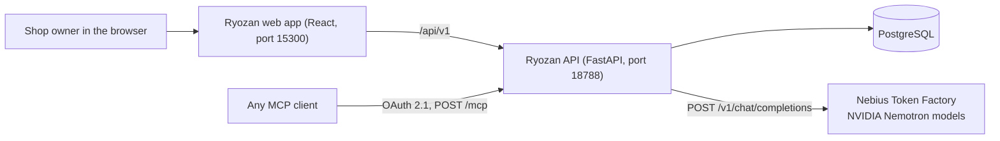

# Ryozan (梁山泊)

**A shop operating system for independent artists and studios, run by a crew of AI agents on NVIDIA Nemotron.**

Ryozan is a full-stack app (FastAPI and React 19) for tattoo studios, barbershops and other creator businesses. The owner talks to a crew of eight agents, styled after the heroes of Ryōzanpaku in Kuniyoshi's *Suikoden* woodblock prints, coordinated by Gala. Each agent deals Action Cards for its part of the shop (bookings, messages, schedule, aftercare, social posts), and every agent turn runs on an NVIDIA Nemotron model served by Nebius Token Factory.

> **Nebius x NVIDIA Global AI Hackathon** · Track: **Best Apps and Agents** · License: **Apache-2.0** ([`LICENSE`](LICENSE))

### Why I built this

> *"I needed help managing my business so I built my shop's app and website from scratch. I taught myself how to develop, build and ship full stack applications using AI. What I didn't expect was to fall in love with the process of architecting orchestrated software and now am founding a tech company called Ark Omnitek made by a tattooer, built for artists and creators. I also wanted to build something that would help other tattooers like my dad. But if it didn't help mine, what good would that do? Once my analytics proved it worked on my shop first, I knew I could confidently give him something that works and put it out there in the world."*
> **Justin Walker**

---

## 1. Ryozan stands on its own

Ryozan is one of three entries by the same author. **Each one installs and runs by itself, and they do not call each other in this build.**

| Repo | What it is | Relationship to Ryozan in this build |
| --- | --- | --- |
| **Ryozan** (this repo) | Shop operating system with an agent crew | Calls Nebius Token Factory directly with your `NEBIUS_API_KEY`. |
| [Holodex](https://github.com/GalaAI/holodex) | Windows desktop companion: cursor, HUD, screen lasso | Separate app. Holodex does not call Ryozan. |
| [Hivemind](https://github.com/GalaAI/hivemind) | Multi-agent MCP server with per-user OAuth adapters | Separate app. Any MCP client, Hivemind included, can connect to Ryozan's own MCP endpoint (below). |



### The MCP surface

The API serves a Model Context Protocol server at `POST /mcp` (Streamable HTTP, stateless JSON responses), implemented in [`api/app/mcp`](api/app/mcp): the transport in `router.py`, the OAuth 2.1 authorization server in `oauth.py`, and the tools in `tools.py` (server name `ryozan`, tools named `ryozan_*`, such as `ryozan_today`, `ryozan_search_bookings` and `ryozan_list_threads`). Tool discovery is filtered by the signed-in account's role and the OAuth scopes it granted (`ryozan.shop.read`, `ryozan.shop.send`, `ryozan.shop.write`).

---

## 2. How Ryozan uses Nemotron and Token Factory

Agent turns are OpenAI-compatible `POST /v1/chat/completions` calls to Nebius Token Factory (`https://api.tokenfactory.nebius.com/v1`). Each agent gets the smallest Nemotron model that does its job well, so the front desk stays fast and credits go to the work that needs reasoning. If an agent's model fails, the call falls back to the tier lane.

| Agent | Shop job | Model id on Token Factory |
| --- | --- | --- |
| **Gala** | Coordinates the crew, settles conflicts between domains | `nvidia/Nemotron-3-Ultra-550b-a55b` |
| **Sōkō** | Shop floor and back of house | `nvidia/nemotron-3-super-120b-a12b` |
| **Shishin** | Flash drops, deposits, ledger | `nvidia/nemotron-3-super-120b-a12b` |
| **Saishin** | Scheduling, chair holds, calendar sync | `nvidia/nemotron-3-super-120b-a12b` |
| **Riki** | Social publishing | `nvidia/nemotron-3-super-120b-a12b` |
| **Ensei** | Front-desk triage for walk-ins and DMs | `nvidia/NVIDIA-Nemotron-3-Nano-30B-A3B` |
| **Taisō** | Unified inbox | `nvidia/NVIDIA-Nemotron-3-Nano-30B-A3B` |
| **Andōzen** | Aftercare, waivers, check-ins | `nvidia/NVIDIA-Nemotron-3-Nano-30B-A3B` |
| **Rochishin** | Flash, style and placement critique (vision) | `nvidia/Nemotron-3.5-Super-VL` |

The model assignments live in `AGENT_PROFILES` in [`api/app/api/v1/endpoints/gala_chat.py`](api/app/api/v1/endpoints/gala_chat.py) (the chat endpoint and its tools); the model client and tier lanes are in [`api/app/services/ai_routing.py`](api/app/services/ai_routing.py). The crew's cards are built in [`app/src/lib/agent-card-hands.ts`](app/src/lib/agent-card-hands.ts), and every card names a tool the agent is allowed to call. Without a key, chat answers with a clear 503 that says to set `NEBIUS_API_KEY`; the rest of the app keeps working.

How a turn runs:

1. The portal posts the message to `POST /api/v1/gala/chat` with the signed-in account's JWT.
2. The API resolves the agent, builds a system prompt scoped to that account's role (a client only ever sees their own bookings, messages and memory), and offers only the tools that agent and role may call.
3. It calls Token Factory's `POST /v1/chat/completions` with the agent's Nemotron model and those tools as OpenAI function definitions (`Authorization: Bearer $NEBIUS_API_KEY`, base URL `https://api.tokenfactory.nebius.com/v1`).
4. When Nemotron asks for a tool, the API runs it against the database or Tavily, returns the result as a `tool` message, and loops (at most 5 rounds) until Nemotron writes the answer.
5. The reply comes back with a receipt per tool call (`tool_calls`) and data cards (`components`) that the portal renders under the answer.

## 2a. How Ryozan uses Tavily

Every agent has a `web_search` tool backed by the [Tavily Search API](https://docs.tavily.com/documentation/api-reference/endpoint/search). Nemotron decides when a question needs the live web (aftercare guidance, a convention date, a pigment regulation, trend research for a flash drop) and calls the tool; the API then makes one `POST https://api.tavily.com/search` with `Authorization: Bearer $TAVILY_API_KEY`, `search_depth: "basic"` (1 credit), up to 5 results and Tavily's short answer. The ranked sources go back to Nemotron, which cites the URLs it used, and the portal shows them as a **web results** card with clickable links. The client is [`api/app/services/web_search.py`](api/app/services/web_search.py); the tool definition and its execution are in `gala_chat.py`. Without `TAVILY_API_KEY` the tool is not offered to any agent.

---

## 2b. Judge accounts on the hosted demo

**Hosted demo:** https://ryozan-production.up.railway.app/portal

Judges have two ways in, and neither involves seeded or mock data:

- **Your own account (recommended).** Choose **Create an account** on the sign-in screen, enter the invite code from the testing instructions, and pick your own email and password. You are signed in at once and see only your own bookings, messages and agent memory.
- **The shared judge account.** Sign in with the email and password from the testing instructions. Its password cannot be changed or reset and the account cannot be deleted, so it keeps working for every judge; anything typed into it is visible to the other judges who use it.

Then ask the agent on your home screen a question. The status line names the Nemotron model and `api.tokenfactory.nebius.com`. Ask for something current ("search the web for...") to see a Tavily-sourced answer with a **web results** card.

The settings live in `api/.env`:

| Variable | What it does |
| --- | --- |
| `OPEN_SIGNUP_ENABLED` | `true` lets `POST /auth/register` create a verified client account and sign it in, with no verification email. |
| `OPEN_SIGNUP_CODE` | Invite code the sign-up form requires, 8 or more characters. Blank keeps instant sign-up closed. |
| `OPEN_SIGNUP_UNTIL` | Last open day (UTC, `YYYY-MM-DD`). After it, sign-up closes and those accounts lose AI access. |
| `OPEN_SIGNUP_MAX_ACCOUNTS` | Cap on accounts created this way (default 200). |
| `TAVILY_MONTHLY_SEARCHES_PER_ACCOUNT` | Tavily searches per account per month (default 25). |
| `DEMO_ACCOUNT_EMAIL`, `DEMO_ACCOUNT_PASSWORD` | The shared judge account, created or repaired at startup ([`api/app/services/demo_account.py`](api/app/services/demo_account.py)). |
| `DEMO_ACCOUNT_MONTHLY_AI_TURNS`, `DEMO_ACCOUNT_MONTHLY_SEARCHES` | Monthly caps for the shared account (defaults 300 and 150), since every judge shares them. |

Each account is a free-tier client: 40 agent turns a month, and every model call counts toward the install's monthly AI budget cap. Sign-up is also rate limited to 5 attempts a minute per IP.

## 3. What's in the repo

```text
ryozan/
├── app/                     React 19 + TypeScript portal (crew, Action Cards, bookings, inbox)
│   └── src/
│       ├── components/desktop-portal/   desktop portal, Hub, ActionDeck
│       └── lib/                         agent-card-hands.ts (the crew), API client
├── api/                     FastAPI backend
│   └── app/
│       ├── api/v1/endpoints/   gala_chat.py (agents), bookings.py, conversations.py, auth.py
│       ├── mcp/                MCP server: router.py, oauth.py, tools.py
│       └── services/           ai_routing.py (Token Factory client and model lanes)
├── packages/
│   ├── ryozan-econ/         Integer-cent double-entry ledger and commission split engine
│   └── ui/                  Component library, vendored into the app as a tarball
├── docker-compose.yml       Local Postgres, API and app, bound to 127.0.0.1
└── docs/QUICKSTART.md       Step-by-step local setup
```

## 4. Quickstart

Full steps, including Windows commands, are in [`docs/QUICKSTART.md`](docs/QUICKSTART.md). In short:

```bash
cp .env.example .env              # POSTGRES_PASSWORD for docker compose
cp api/.env.example api/.env      # then set NEBIUS_API_KEY in api/.env
docker compose up -d db api app
# first account; the compose database is reached as host "db", so name it as local
docker compose exec api python scripts/bootstrap_dev_login.py --allow-nonlocal-db
```

Open http://localhost:15300, choose **Open the studio portal** and sign in with the printed founder account. Connectors (Stripe, Google Calendar, Pinterest, email, SMS) stay hidden until their keys are set in `api/.env`.

### Tests

```bash
# API unit tests
cd api && python -m unittest discover -s tests -p "*_tests.py" && cd ..

# Ledger engine
cd packages/ryozan-econ && PYTHONPATH=. python -m unittest discover -s tests -p "*_tests.py" && cd ../..

# Vendored UI tarball integrity
node scripts/check-ui-tarball.mjs

# Portal, crew and Action Card tests (install app dependencies first)
cd app && npm ci && node --test $(git ls-files "*.test.mjs") && cd ..
```

## Built during the submission period

Ryozan's shop platform existed before 2026-08-26. During the hackathon window it gained the agent crew and its Nemotron model assignments on Token Factory, the Action Card portal, the MCP server rename and cleanup, and the `ryozan-econ` ledger package. This repository was published on 2026-10-28.

## License

Apache License 2.0, see [`LICENSE`](LICENSE).
